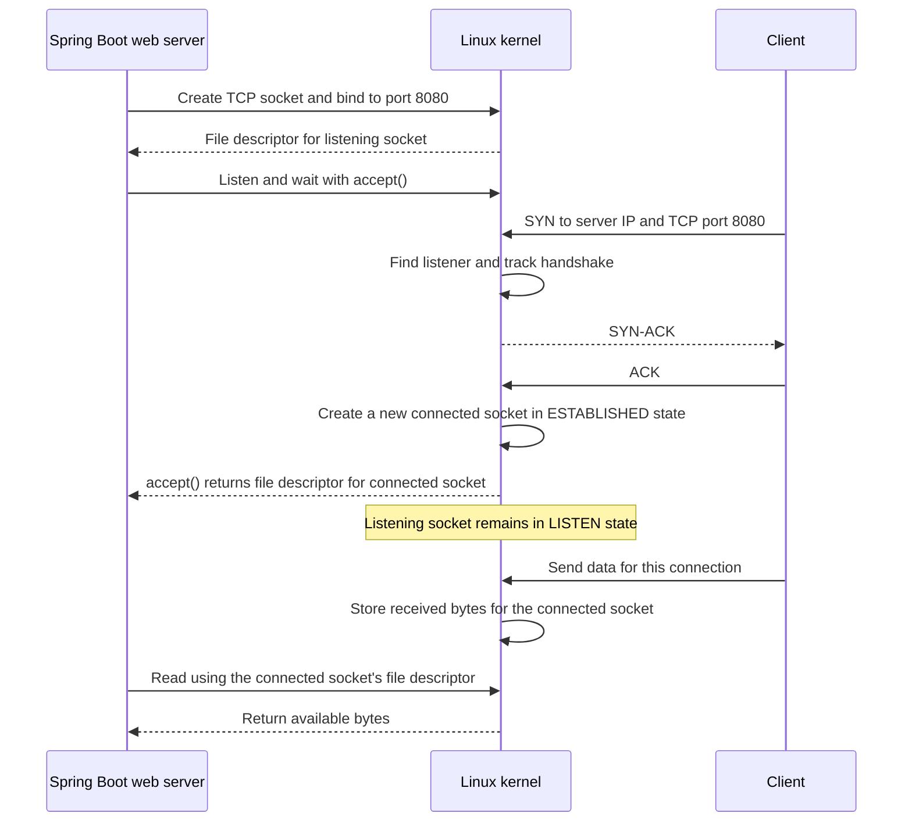

# Connections

**Breadcrumbs:** [Home](../../README.md) / [Fundamentals](../README.md) / [Networking](README.md) / Connections

## Index

1. [What a TCP connection is](#1-what-a-tcp-connection-is)
2. [What a socket is](#2-what-a-socket-is)
3. [How a server handles clients](#3-how-a-server-handles-clients)
4. [The connection sequence](#4-the-connection-sequence)

## 1. What a TCP connection is

A TCP connection lets a client and a server exchange data. Each machine's Linux kernel keeps information about that connection.

After the TCP handshake, the connection is in the `ESTABLISHED` state. The kernels use the connection information to deliver data to the right client and server. When either side closes the connection, TCP goes through closing steps and eventually removes that information.

## 2. What a socket is

A **socket** is a resource managed by the operating system. A program uses it to send and receive network data.

When a program asks Linux to create a socket, it specifies TCP or UDP. Linux uses that choice to decide how the socket behaves:

- A TCP socket can establish connections and keep connection state.
- A UDP socket sends and receives separate messages. It does not use the TCP handshake or TCP connection states.

A standard Spring Boot HTTP server uses TCP. Its embedded web server asks Linux to create a TCP socket and bind it to a port such as `8080`.

Linux gives the program an integer called a **file descriptor**. The program uses this number when asking Linux to work with the socket. The file descriptor is the number; the socket is the resource managed by Linux.

## 3. How a server handles clients

For a simple TCP server, Linux has:

- One **listening socket** for the server's IP address and port, such as TCP port `8080`. Its state is `LISTEN`.
- One **connected socket** for each client whose connection has been accepted. Its state is `ESTABLISHED` after the handshake.

The listening socket waits for new clients. It does not carry the data for each client. Linux creates a connected socket for a client after the TCP handshake completes. The server calls `accept()` to receive a file descriptor for that socket. The listening socket stays in `LISTEN` for other clients.

The client also has its own connected socket. Each side's kernel manages its own socket and connection information.

## 4. The connection sequence

In the diagram, the Spring Boot web server asks Linux to create and listen with a TCP socket. When the handshake completes, Linux gives the server a file descriptor for the connected socket through `accept()`.

The application uses the connected socket's file descriptor to read or write data. Linux handles the TCP packets and keeps the connection state.
